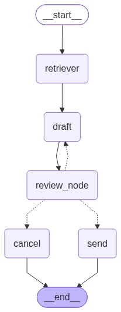

# Email Agent

An agentic email drafting and sending assistant built with LangGraph and Groq. It extracts recipient details and the reason for an email from a natural-language request, drafts the email, allows human-in-the-loop review with feedback, and sends it via Gmail SMTP.

## Overview

```
START -> retriever -> draft -> review_node -> (send | draft | cancel) -> END
```

- **retriever**: Extracts `mail_reason`, `recipient_name`, and `recipient_email` from the user's query using a structured LLM output.
- **draft**: Generates subject and body (max ~200 words), incorporating feedback on revisions.
- **review_node**: Interrupts execution for human approval or feedback (max 3 feedback rounds).
- **send**: Sends the approved email through Gmail SMTP.
- **cancel**: Stops after exceeding the feedback limit.

## Demo



## Project Structure

```
Email_agent/
├── agent.py          # LangGraph workflow definition
├── send_email.py     # Gmail SMTP sending logic
├── requirements.txt  # Python dependencies
├── .env.sample       # Environment variable template
└── test.ipynb        # Notebook for testing
```

## Setup

1. Create and activate a virtual environment:

   ```bash
   python -m venv venv
   venv\Scripts\activate
   ```

2. Install dependencies:

   ```bash
   pip install -r requirements.txt
   ```

3. Configure environment variables by copying `.env.sample` to `.env` and filling in values:

   ```env
   GROQ_API_KEY="your_groq_api_key"
   SENDER_EMAIL="your_email@gmail.com"
   SENDER_PASSWORD="your_gmail_app_password"
   ```

   Use a Gmail App Password, not your primary account password.

## Usage

Run the agent programmatically:

```python
from agent import final_graph
from langchain_core.messages import HumanMessage

config = {"configurable": {"thread_id": "1"}}
result = final_graph.invoke({"question": "Send an email to John at john@example.com about the project update"}, config=config)
```

When the graph pauses at `review_node`, resume with feedback or approval:

```python
from langgraph.types import Command

final_graph.invoke(Command(resume="yes"), config=config)   # approve and send
final_graph.invoke(Command(resume="Make it more formal"), config=config)  # revise
```

## Requirements

See `requirements.txt`. Key dependencies: `langchain`, `langgraph`, `langchain-groq`, `pydantic`, `python-dotenv`.
